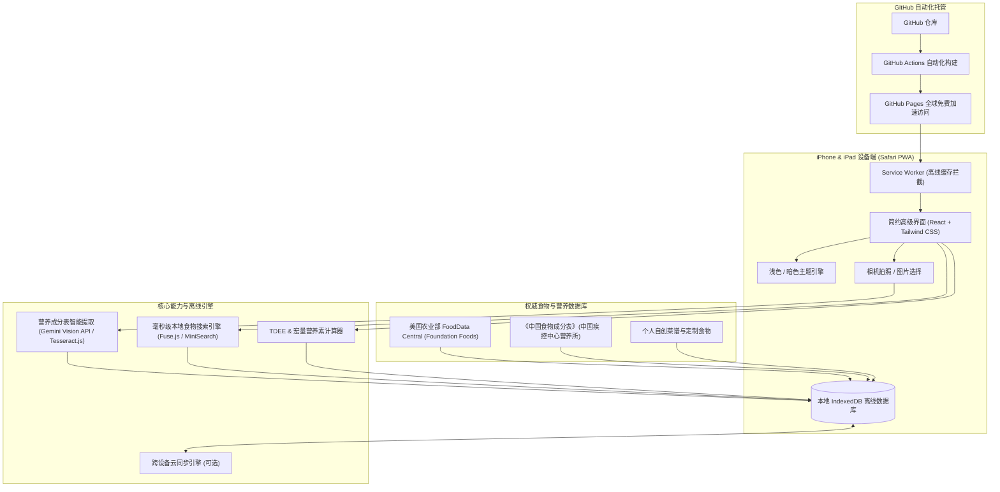
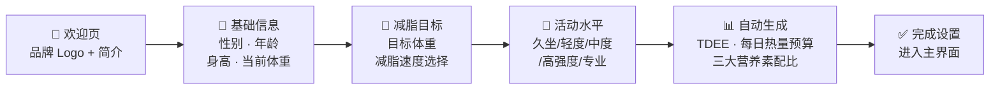
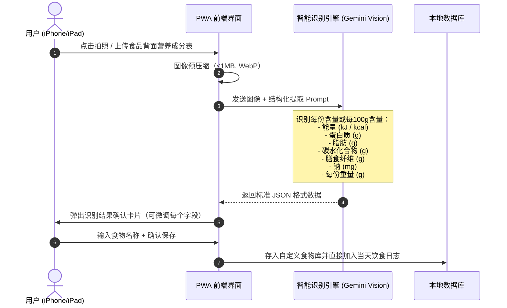
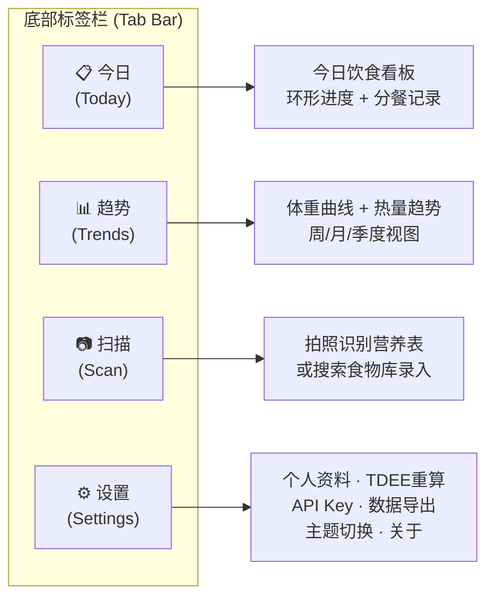

# CaloBuddy - 个人减脂热量计算与饮食追踪应用详细设计方案 v2.0

本项目专为 iOS / iPadOS 个人体验量身定制，基于 **PWA (Progressive Web App)** 纯前端单页架构，免去证书签名与 7 天过期烦恼，完美支持部署在 GitHub Pages 上并通过 Safari 添加到主屏幕以原生级全屏模式运行。

---

## 一、 系统架构与部署模型



### 技术栈明细

| 层级 | 选型 | 说明 |
| :--- | :--- | :--- |
| **构建工具** | Vite 6.x | 极速 HMR、Tree-shaking、代码分割 |
| **UI 框架** | React 19 + TypeScript 5.x | 类型安全、组件化 |
| **样式引擎** | Tailwind CSS 4.x | 原子化 CSS、暗色模式 `dark:` 前缀一键切换 |
| **图表库** | Recharts（或 Chart.js） | 轻量化折线图、环形图渲染 |
| **本地存储** | Dexie.js (IndexedDB 封装) | Promise 化 API、索引查询、事务安全 |
| **模糊搜索** | Fuse.js | 支持拼音首字母/模糊匹配/权重排序 |
| **拼音支持** | pinyin-pro | 中文 → 拼音首字母转换，搜索增强 |
| **PWA 插件** | vite-plugin-pwa (Workbox) | 自动生成 Service Worker、离线缓存策略 |
| **视觉识别** | Google Gemini 2.0 Flash API | 拍照识别营养成分表（API Key 纯本地存储） |
| **OCR 兜底** | Tesseract.js 5.x | 无网络时端侧 OCR 文字提取 |
| **动画** | Framer Motion | 流畅的页面转场与微交互动效 |
| **日期处理** | date-fns | 轻量级日期格式化与计算 |
| **UUID 生成** | nanoid | 极轻量唯一 ID 生成器 |

---

## 二、 权威食物数据库选型与数据处理

为了确保营养数据的绝对权威与严谨，避免市面普通 App 用户随意上传产生的脏数据，数据源采用**双轨国际与国家标准**：

### 1. 数据来源

| 数据源 | 权威等级 | 覆盖侧重 | 获取方式 |
| :--- | :--- | :--- | :--- |
| **USDA FoodData Central (SR Legacy & Foundation Foods)** | 全球科研金标准 | 基础肉类、蛋奶、蔬果坚果、海鲜（生熟状态） | 官方公开 JSON/CSV API 下载 |
| **《中国食物成分表》第6版（中国疾控中心营养所）** | 国家标准 | 杂粮饭、馒头、绿叶菜、食用油、中式豆制品、常见中餐菜品 | 标准出版物数据整理 |
| **用户自定义食物** | 个人自建 | 私房菜谱、特定品牌食品（如拍照导入） | 手动或拍照录入 |

### 2. 食物分类体系

将所有食材划分为以下 **12 个实用分类**（比原方案 7 类更贴合中国减脂饮食习惯）：

| 分类编码 | 类别名称 | 典型食材举例 |
| :--- | :--- | :--- |
| `staple` | 🍚 主食谷薯 | 白米饭、糙米饭、燕麦、全麦面包、红薯、玉米、馒头、面条 |
| `meat` | 🥩 畜禽肉类 | 鸡胸肉、牛腱、猪里脊、羊腿肉 |
| `seafood` | 🐟 鱼虾水产 | 三文鱼、鳕鱼、虾仁、金枪鱼罐头 |
| `egg` | 🥚 蛋类 | 鸡蛋（全蛋/蛋白）、鹌鹑蛋 |
| `dairy` | 🥛 乳制品 | 脱脂牛奶、希腊酸奶、芝士、乳清蛋白粉 |
| `soy` | 🫘 豆类豆制品 | 豆腐、豆浆、毛豆、豆腐干、豆皮 |
| `vegetable` | 🥬 蔬菜 | 西兰花、菠菜、生菜、番茄、黄瓜、芹菜 |
| `fruit` | 🍎 水果 | 苹果、香蕉、蓝莓、橙子、牛油果 |
| `nut` | 🥜 坚果种子 | 杏仁、核桃、花生、腰果、奇亚籽 |
| `oil` | 🫒 油脂调味 | 橄榄油、花生油、芝麻油、黄油、沙拉酱 |
| `snack` | 🍫 零食饮品 | 蛋白棒、黑巧克力、咖啡、果汁、碳酸饮料 |
| `custom` | ⭐ 自定义 | 拍照导入食品、手动录入的自创菜品 |

### 3. 常用份量快捷模板

> [!IMPORTANT]
> 减脂记录的核心痛点是"不知道一份是多少克"。内置**生活化常用份量**是提升体验的关键。

除了默认的"每100g"基准外，每种食材额外预设 1~3 个**日常份量快捷选项**：

| 食材 | 快捷份量选项 |
| :--- | :--- |
| 白米饭 | 1 小碗 (150g) · 1 标准碗 (200g) · 1 大碗 (300g) |
| 鸡胸肉 | 1 小块 (100g) · 1 整块 (150g) · 1 大块 (200g) |
| 鸡蛋 | 1 个全蛋 (50g) · 1 个蛋白 (33g) |
| 牛奶 | 1 盒 (250ml/258g) · 1 杯 (200ml) |
| 苹果 | 1 个小果 (150g) · 1 个中果 (200g) |
| 食用油 | 1 茶匙 (5g) · 1 汤匙 (15g) |
| 面条（生） | 1 人份 (100g) · 1 大份 (150g) |

用户在搜索选中食材后，可以直接**点选份量胶囊标签**（如 `1碗` `1块` `1个`），也可以手动输入精确克数。

### 4. 数据精炼与离线打包策略

* 将两库中日常减脂最常见的 **1,500 ~ 2,500 种标准食材与菜品**进行清洗去重与单位标准化（统一折算为 `每100g` 能量、蛋白质、脂肪、碳水化合物、膳食纤维、钠）。
* 预编译为极轻量的结构化本地 JSON 索引（压缩后 < 300KB），首次加载后全部缓存至本地 IndexedDB。
* 构建时自动为每条食物生成**拼音首字母索引**（如"鸡胸肉" → `jxr`），支持拼音快速检索。
* **完全无网络环境下也能毫秒级搜索检索**。

---

## 三、 用户引导与个性化设置（新增章节）

> [!NOTE]
> 原方案完全缺失用户首次使用时的个人信息采集与 TDEE 自动计算流程。这是减脂应用的基础能力。

### 1. 首次启动引导流（Onboarding Flow）



### 2. TDEE 与热量预算自动计算

采用全球营养学界公认最准确的 **Mifflin-St Jeor 公式**：

$$
BMR_{男} = 10 \times W + 6.25 \times H - 5 \times A - 161 + 166
$$
$$
BMR_{女} = 10 \times W + 6.25 \times H - 5 \times A - 161
$$

其中 W = 体重(kg)，H = 身高(cm)，A = 年龄(岁)。

然后乘以活动系数得到 TDEE（日常总能量消耗）：

| 活动水平 | 系数 | 描述 |
| :--- | :--- | :--- |
| 久坐不动 | 1.2 | 办公室久坐，几乎不运动 |
| 轻度活动 | 1.375 | 每周运动 1–3 天 |
| 中度活动 | 1.55 | 每周运动 3–5 天 |
| 高强度 | 1.725 | 每周运动 6–7 天 |
| 专业运动 | 1.9 | 每天高强度训练或体力劳动 |

**减脂热量预算 = TDEE − 每日热量缺口**

提供三档减脂速度预设：

| 档位 | 每日缺口 | 预计周减重 | 适合人群 |
| :--- | :--- | :--- | :--- |
| 🐢 温和减脂 | −300 kcal | ≈ 0.3 kg/周 | 不赶时间、追求舒适持续 |
| 🏃 标准减脂 | −500 kcal | ≈ 0.5 kg/周 | 大多数人推荐 |
| 🔥 快速减脂 | −750 kcal | ≈ 0.7 kg/周 | 基数较大、短期冲刺（不建议长期） |

### 3. 三大营养素智能配比（减脂专用）

根据目标热量自动分配蛋白质 / 碳水 / 脂肪的克数：

| 营养素 | 减脂期推荐占比 | 分配逻辑 |
| :--- | :--- | :--- |
| **蛋白质** | 30~35% | 按 1.6~2.2 g/kg 体重优先锁定（保肌肉） |
| **脂肪** | 20~25% | 按热量占比计算，不低于 0.8 g/kg 体重（保激素水平） |
| **碳水化合物** | 40~50% | 剩余热量全部分配给碳水 |

用户可在设置中选择"自动推荐"或"手动自定义比例"。

---

## 四、 拍照识别热量表（营养成分表）技术方案

在减脂过程中，超市购买的预包装食品（如全麦面包、鸡胸肉肠、蛋白粉、酸奶）背面都有法定标准的"营养标签（Nutrition Facts）"。



### 识别方案分层

1. **智能视觉提取（首选，准确率 99%+）**：
   * 调用 Google Gemini 2.0 Flash Vision API，发送 Prompt 要求以 JSON Schema 格式返回结构化营养数据。
   * 自动纠正千焦（kJ）与大卡（kcal）的换算（1 kcal = 4.184 kJ）。
   * 自动识别"每份"与"每100g"的基准差异并统一折算。
   * API Key 完全存储在用户本机设备 (IndexedDB)，通过 HTTPS 直连 Google 服务器，不经过任何中间人。
2. **离线纯本地兜底方案（Tesseract.js OCR）**：
   * 若无网络或不想配置 API Key，可直接用轻量级端侧 OCR 提取文本，结合正则模式匹配"能量"、"蛋白质"、"脂肪"后面的数字。
3. **手动快捷补充**：
   * 提供极简数字输入框，只需输 4 个数字（大卡、蛋白质、碳水、脂肪），3 秒完成录入。

### Gemini Vision API Prompt 设计

```text
请分析这张食品营养成分表图片，提取以下信息并以 JSON 格式返回：
{
  "productName": "产品名称（如果能识别到）",
  "servingSize": "每份重量(g)，如果是每100g则填100",
  "calories": "能量(kcal)，如果原始单位是kJ请自动除以4.184转换",
  "protein": "蛋白质(g)",
  "fat": "总脂肪(g)",
  "carbs": "碳水化合物(g)",
  "fiber": "膳食纤维(g)，如果没有则填null",
  "sodium": "钠(mg)",
  "sugar": "糖(g)，如果没有则填null"
}
请确保所有数值为纯数字（不带单位），如无法识别某项则填 null。
```

---

## 五、 界面视觉与交互规范（简约高级设计）

整体采用 **Apple HIG (人机界面指南)** 风格与包豪斯极简美学，拒绝花哨冗余的按钮，注重信息密度、高对比度阅读与精致微动效。

### 1. 配色方案与双模设计

| 维度 | 浅色模式 (Light Luxury) | 暗色模式 (OLED Obsidian) |
| :--- | :--- | :--- |
| **主背景** | `#F6F7F9` 极低饱和米灰 | `#0A0B0D` 深邃纯黑 (OLED 省电) |
| **卡片背景** | `#FFFFFF` 纯白微阴影浮层 | `#14161A` 暗黑浮层 + 1px `rgba(255,255,255,0.06)` 轮廓 |
| **二级背景** | `#F0F1F3` 分区底色 | `#1A1C21` 内嵌面板底色 |
| **主文字** | `#111827` 炭黑 | `#F3F4F6` 高透白 |
| **二级文字** | `#6B7280` 中灰 | `#9CA3AF` 柔灰 |
| **三级文字/占位符** | `#D1D5DB` | `#4B5563` |
| **分割线** | `#E5E7EB` | `#1F2937` |
| **热量主色 (Calories)** | `#10B981` 薄荷翠绿 | `#34D399` 柔和荧光薄荷绿 |
| **蛋白质 (Protein)** | `#6366F1` 雅致靛蓝 | `#818CF8` 薰衣草蓝 |
| **碳水 (Carbs)** | `#F59E0B` 暖调琥珀黄 | `#FBBF24` 柔和琥珀金 |
| **脂肪 (Fat)** | `#F43F5E` 玫瑰胭脂红 | `#FB7185` 珊瑚玫瑰红 |
| **警告/超标** | `#EF4444` 鲜红 | `#F87171` 亮红 |
| **成功/达标** | `#22C55E` 翠绿 | `#4ADE80` 亮绿 |

**主题切换机制**：
* 默认跟随系统（`prefers-color-scheme`）自动切换。
* 支持在设置页手动固定为"始终浅色"或"始终暗色"。
* 切换时使用 Framer Motion `layoutAnimation` 实现丝滑过渡（200ms ease-out）。

### 2. 字体与排版规范

| 用途 | 字体 | 字号 | 字重 |
| :--- | :--- | :--- | :--- |
| 页面大标题 | SF Pro Display (系统) | 28px | Bold (700) |
| 卡片标题 | SF Pro Display | 18px | Semibold (600) |
| 数字（热量/克数） | SF Pro Rounded / Tabular | 32~48px | Bold (700) |
| 正文/描述 | SF Pro Text | 15px | Regular (400) |
| 辅助说明/标签 | SF Pro Text | 12px | Medium (500) |

> [!TIP]
> 所有数字使用 `font-variant-numeric: tabular-nums` 确保等宽对齐，数字跳动时不会造成界面抖动。

### 3. 全局页面导航结构



### 4. 核心界面板块详细设计

#### 4.1 今日饮食看板 (Today)

```
┌──────────────────────────────────────┐
│  ☀️ 10月28日 · 周三              [🌙]│  ← 日期 + 暗色模式切换
│                                      │
│         ╭───────────╮                │
│        ╱  剩余可摄入  ╲               │
│       │    856       │               │  ← 中央大环形进度（热量）
│       │    kcal      │               │
│        ╲  已摄入 944  ╱               │
│         ╰───────────╯                │
│   目标: 1,800 kcal                    │
│                                      │
│  ┌──────┐ ┌──────┐ ┌──────┐         │
│  │蛋白质 │ │碳水  │ │ 脂肪 │         │  ← 三大营养素胶囊进度条
│  │87/135g│ │102/202g│ │31/45g│        │
│  │██████░│ │█████░░│ │████░░│         │
│  │ 靛蓝  │ │ 琥珀  │ │ 玫红 │         │
│  └──────┘ └──────┘ └──────┘         │
│                                      │
│  ── 🌅 早餐  共 320 kcal ──────────  │  ← 分餐卡片区
│  │ 🥣 燕麦粥        60g   148 kcal │  │
│  │ 🥚 煮鸡蛋(2个)   100g  144 kcal │  │
│  │ 🫐 蓝莓          30g    28 kcal │  │
│  └──────────────────────────────── ┘  │
│                                      │
│  ── 🌞 午餐  共 484 kcal ──────────  │
│  │ 🍚 糙米饭       150g   166 kcal │  │
│  │ 🍗 鸡胸肉       150g   232 kcal │  │
│  │ 🥦 西兰花        80g    27 kcal │  │
│  │ 🫒 橄榄油        5g     44 kcal │  │
│  └──────────────────────────────── ┘  │
│                                      │
│  ── 🌆 晚餐  点击添加 ─────────────  │
│  ── 🌙 加餐  点击添加 ─────────────  │
│                                      │
│ ┌──────────────────────────────────┐ │
│ │  🔍 搜索食物  │  📷 拍照  │  ⚡ 快录│ │  ← 底部毛玻璃浮动操作栏
│ └──────────────────────────────────┘ │
└──────────────────────────────────────┘
```

#### 4.2 分餐录入细节

* 每餐卡片默认**折叠显示**（仅显示该餐总热量），点击展开查看明细食材。
* **左滑单条食材** → 显示红色"删除"按钮。
* **点击食材行** → 弹出底部半屏面板，可修改克数（滑动选择器或直接输入），实时联动显示热量变化。
* **长按食材** → 显示"复制到其他餐次"选项。

#### 4.3 食物搜索与录入面板

```
┌──────────────────────────────────────┐
│  🔍 搜索食物...                   [×]│  ← 搜索输入框 (支持中文/拼音/英文)
│                                      │
│  ⏱ 最近使用                          │  ← 快速复用
│  ┌────────────────────────────────┐   │
│  │ 🍗 鸡胸肉  │ 🍚 糙米饭  │ 🥚 鸡蛋│  │
│  └────────────────────────────────┘   │
│                                      │
│  ⭐ 我的收藏                          │  ← 收藏夹
│  ┌────────────────────────────────┐   │
│  │ 🥗 减脂沙拉(自定义) │ 🥤 蛋白粉 │  │
│  └────────────────────────────────┘   │
│                                      │
│  ── 搜索结果 ──────────────────────   │
│  │ 🥩 鸡胸肉（去皮·生）           │   │
│  │    USDA · 每100g: 165kcal       │   │
│  │    蛋白质31g · 碳水0g · 脂肪3.6g │   │
│  │    [ 1块100g ] [ 1块150g ] [自定义]│  │  ← 快捷份量标签
│  └─────────────────────────────────   │
│  │ 🍗 鸡胸肉（去皮·熟/水煮）      │   │
│  │    中国食物成分表 · 每100g: 133kcal│  │
│  │    蛋白质29g · 碳水1.3g · 脂肪1.2g│  │
│  └─────────────────────────────────   │
└──────────────────────────────────────┘
```

#### 4.4 趋势分析页 (Trends)

* **上半区：体重趋势折线图**
  - X 轴为日期，Y 轴为体重 (kg)。
  - 同时叠加一条**7日移动平均线**（消除日常波动噪声，更准确反映真实趋势）。
  - 可切换时间窗口：近 7 天 / 30 天 / 90 天 / 全部。
* **下半区：热量摄入柱状图**
  - 每日实际摄入 vs 目标线（虚线水平参考）。
  - 超标日标红色，达标日标绿色。
* **统计卡片区**：
  - 本周平均摄入热量 / 平均蛋白质摄入。
  - 本周平均热量缺口。
  - 累计减重 / 距离目标体重还差多少。

### 5. iPad 自适应大屏布局

> [!NOTE]
> iPad 屏幕更大（10.9" ~ 12.9"），简单拉伸手机布局会导致信息稀疏、留白过多。需要专门优化。

* **横屏 / 大屏模式**：采用**双栏布局**：
  - 左侧固定 40% 宽度：今日环形看板 + 营养素概览（始终可见）。
  - 右侧 60%：分餐记录流（可滚动）。
* **趋势页**：图表可以更大，横向展示更多日期数据点。
* **断点策略**：`< 768px` 手机单栏 → `≥ 768px` iPad 双栏。

### 6. 动效与微交互规范

| 场景 | 动效 | 时长 & 曲线 |
| :--- | :--- | :--- |
| 页面切换（Tab） | 淡入淡出 + 微上移 | 200ms ease-out |
| 卡片展开/折叠 | 高度渐变 + 内容淡入 | 250ms spring |
| 环形进度更新 | 弧度动画从当前值流动到新值 | 600ms ease-in-out |
| 营养素进度条 | 宽度渐变填充 | 400ms ease-out |
| 新增食材 | 从底部滑入 + 缩放弹跳 | 300ms spring |
| 左滑删除 | 红色背景展开 | 150ms linear |
| 底部操作栏 | 毛玻璃 `backdrop-filter: blur(20px)` | 常驻 |
| 拍照识别加载 | 骨架屏脉冲 + 旋转扫描线 | 持续至完成 |

---

## 六、 数据结构设计

数据完全驻留在浏览器 `IndexedDB`（通过 Dexie.js 封装），保证无网络时也能闪电加载。

```typescript
// ─── 1. 用户档案 ───
interface UserProfile {
  gender: 'male' | 'female';
  birthYear: number;
  heightCm: number;
  currentWeightKg: number;
  targetWeightKg: number;
  activityLevel: 'sedentary' | 'light' | 'moderate' | 'active' | 'very_active';
  deficitMode: 'mild' | 'standard' | 'aggressive'; // 温和/标准/快速
  // 自动计算字段
  bmr: number;
  tdee: number;
  targetCalories: number;
  targetProtein: number;  // g
  targetFat: number;      // g
  targetCarbs: number;    // g
  // API 设置
  geminiApiKey?: string;
  // 偏好
  theme: 'system' | 'light' | 'dark';
  createdAt: number;
  updatedAt: number;
}

// ─── 2. 食物定义 ───
interface FoodItem {
  id: string;
  name: string;
  nameEn?: string;             // 英文名（辅助搜索）
  pinyinIndex: string;         // 拼音首字母索引 (如 "jxr")
  category: FoodCategory;
  source: 'USDA' | 'CDC_CHINA' | 'USER_CUSTOM' | 'OCR_SCANNED';
  per100g: NutritionPer100g;
  commonServings?: ServingOption[]; // 常用份量预设
  isFavorite?: boolean;        // 是否收藏
  lastUsedAt?: number;         // 最近使用时间（排序用）
  useCount?: number;           // 使用次数（推荐用）
}

interface NutritionPer100g {
  calories: number;  // kcal
  protein: number;   // g
  fat: number;       // g
  carbs: number;     // g
  fiber?: number;    // g
  sodium?: number;   // mg
  sugar?: number;    // g
}

interface ServingOption {
  label: string;     // 如 "1碗" "1个" "1块"
  grams: number;     // 该份量对应克数
}

type FoodCategory =
  | 'staple' | 'meat' | 'seafood' | 'egg' | 'dairy'
  | 'soy' | 'vegetable' | 'fruit' | 'nut' | 'oil'
  | 'snack' | 'custom';

// ─── 3. 单日饮食日志 ───
interface DailyLog {
  date: string;                // YYYY-MM-DD (主键)
  weight?: number;             // 当天体重打卡
  bodyFatPct?: number;         // 体脂率（可选）
  targetCalories: number;      // 当天设定目标
  note?: string;               // 当天备注
  meals: {
    breakfast: MealEntry[];
    lunch: MealEntry[];
    dinner: MealEntry[];
    snacks: MealEntry[];
  };
  // 运行时汇总（由 UI 实时计算，不持久化）
}

interface MealEntry {
  entryId: string;             // nanoid 生成的唯一 ID
  foodId: string;              // 关联 FoodItem.id
  name: string;                // 冗余存储食物名（快速展示）
  grams: number;               // 实际摄入克数
  calories: number;            // 按比例折算后的数值
  protein: number;
  fat: number;
  carbs: number;
  timestamp: number;           // 录入时间戳
}

// ─── 4. Dexie 数据库定义 ───
// db.version(1).stores({
//   profile: '++id',
//   foods: 'id, name, pinyinIndex, category, source, lastUsedAt, useCount',
//   dailyLogs: 'date',
// });
```

---

## 七、 数据安全与跨设备同步策略（新增章节）

> [!WARNING]
> IndexedDB 数据仅存储在单个浏览器内。如果用户清除 Safari 数据、或需要在 iPhone 和 iPad 之间同步，数据会丢失或不一致。必须设计备份与同步方案。

### 1. 本地手动导出/导入（基础保障）

* **一键导出**：在设置页点击"导出数据"，将所有饮食日志、体重记录、自定义食物打包为一个 `.json` 文件，通过系统分享面板保存到 iCloud Drive / 微信 / 邮件。
* **一键导入**：选择之前导出的 `.json` 文件，智能合并（按日期去重，新数据覆盖旧数据）。
* **CSV 导出**：支持将历史数据导出为 `.csv` 格式，可用 Excel 打开分析。

### 2. iPhone ↔ iPad 自动同步（进阶方案，可选实现）

如果后期需要双设备自动同步，可采用以下轻量方案之一：

| 方案 | 复杂度 | 说明 |
| :--- | :--- | :--- |
| **iCloud KVS (键值存储)** | ★★☆ | 利用 Safari PWA 对 iCloud 的原生支持（如果 iOS 26 已开放） |
| **GitHub Gist 云存储** | ★★☆ | 利用 GitHub Personal Access Token，将数据加密后存储到私有 Gist，双设备轮询同步 |
| **Firebase Realtime DB 免费层** | ★★★ | Google Firebase 免费层足够个人使用（1GB 存储，10GB/月流量），支持实时双向同步 |

> 首期优先实现**手动导出/导入**，确保数据绝不丢失；云同步作为后续增强功能。

---

## 八、 饮水追踪（新增模块）

> [!TIP]
> 减脂期间充足饮水对代谢率、饱腹感和运动恢复都至关重要。追踪饮水几乎是减脂类应用的标配功能。

### 设计概要

* 默认每日饮水目标：**2000 ml**（可在设置中自定义，如 2500ml / 3000ml）。
* 在今日看板的营养素区域下方增加一个**水滴进度指示器**。
* 快捷录入按钮：`+250ml（一杯）` `+500ml（一瓶）` `+自定义`。
* 每次点击即累加，支持撤销最近一次。

### 数据结构扩展

```typescript
// 在 DailyLog 中新增
interface DailyLog {
  // ... 原有字段 ...
  waterMl: number;           // 今日已饮水 (ml)
  targetWaterMl: number;     // 今日目标饮水
}
```

---

## 九、 常用搭配与餐食模板（新增模块）

> [!NOTE]
> 减脂期间很多人每天吃的东西高度重复（如固定的早餐搭配）。提供"一键复用"能力可以大幅减少录入时间。

### 功能设计

1. **一键复制昨天的某餐**：
   * 在空白餐次点击时，弹出选项："从昨天复制早餐/午餐/晚餐"。
2. **保存为餐食模板**：
   * 对已录入的一餐，点击 `···` 更多菜单 → "保存为模板"。
   * 给模板命名（如"标准减脂早餐"、"训练日午餐"），随时一键调用。
3. **常用组合推荐**：
   * 根据用户历史使用频率，自动推荐"你最常吃的早餐组合"。

### 数据结构扩展

```typescript
interface MealTemplate {
  id: string;
  name: string;               // 如 "标准减脂早餐"
  items: TemplateItem[];
  totalCalories: number;       // 预计算的总热量
  createdAt: number;
  usageCount: number;
}

interface TemplateItem {
  foodId: string;
  name: string;
  defaultGrams: number;
}
```

---

## 十、 iOS PWA 专项适配（新增章节）

> [!IMPORTANT]
> iOS 上的 PWA 有一些与 Android 不同的特殊行为和限制，必须专门适配才能达到原生级体验。

### 1. PWA Manifest 关键配置

```json
{
  "name": "CaloBuddy",
  "short_name": "CaloBuddy",
  "description": "个人减脂热量追踪器",
  "start_url": "/CaloBuddy/",
  "scope": "/CaloBuddy/",
  "display": "standalone",
  "orientation": "portrait-primary",
  "background_color": "#F6F7F9",
  "theme_color": "#10B981",
  "icons": [
    { "src": "icons/icon-192.png", "sizes": "192x192", "type": "image/png" },
    { "src": "icons/icon-512.png", "sizes": "512x512", "type": "image/png" },
    { "src": "icons/icon-maskable-512.png", "sizes": "512x512", "type": "image/png", "purpose": "maskable" }
  ]
}
```

### 2. iOS 特殊适配清单

| 适配项 | 处理方案 |
| :--- | :--- |
| **状态栏颜色** | `<meta name="apple-mobile-web-app-status-bar-style" content="black-translucent">` 实现沉浸式状态栏 |
| **安全区域** | 使用 `env(safe-area-inset-top/bottom)` 适配 iPhone 刘海与底部横条 |
| **启动画面** | 提供多分辨率 `apple-touch-startup-image` 避免白屏闪烁 |
| **禁止弹性滚动** | `overscroll-behavior: none` 防止过度拉拽露出空白 |
| **输入框自动缩放** | `<meta name="viewport">` 中设置 `maximum-scale=1` 防止 iOS 对 input 自动放大 |
| **底部安全区** | 底部操作栏 `padding-bottom: env(safe-area-inset-bottom)` 避开 Home Indicator |
| **字体渲染** | `-webkit-font-smoothing: antialiased` 确保字体渲染清晰 |

### 3. Service Worker 离线策略

| 资源类型 | 缓存策略 | 说明 |
| :--- | :--- | :--- |
| HTML / JS / CSS | CacheFirst + 版本号 | 首次加载后完全离线可用，新版本发布后自动更新 |
| 食物数据库 JSON | CacheFirst | 预缓存至 Cache Storage，离线不受影响 |
| 字体/图标 | CacheFirst | 长期缓存 |
| Gemini API 请求 | NetworkOnly | 仅在线时可用，失败降级为手动输入提示 |

---

## 十一、 设置页功能清单（新增章节）

| 设置项 | 说明 |
| :--- | :--- |
| **个人资料** | 修改性别、年龄、身高 → 自动重算 TDEE 与目标 |
| **当前体重** | 更新后自动修正 TDEE（体重变化 > 2kg 时提示重算） |
| **减脂速度** | 温和 / 标准 / 快速 三档切换 |
| **营养素比例** | 自动推荐 / 手动自定义（滑块调节蛋白质/碳水/脂肪百分比） |
| **每日饮水目标** | 默认 2000ml，支持自定义 |
| **Gemini API Key** | 输入 / 修改 / 删除 Key（用于拍照识别），密码遮罩显示 |
| **外观主题** | 跟随系统 / 始终浅色 / 始终暗色 |
| **数据导出** | 导出为 JSON / CSV 文件 |
| **数据导入** | 从 JSON 文件恢复/合并 |
| **清除所有数据** | 二次确认后清空（不可逆） |
| **关于** | 版本号、数据来源说明、开源许可声明 |

---

## 十二、 性能预算与优化指标（新增章节）

| 指标 | 目标值 | 优化手段 |
| :--- | :--- | :--- |
| **首次加载 (FCP)** | < 1.5s (4G) | Vite 代码分割、Tree-shaking、gzip |
| **可交互时间 (TTI)** | < 2s | 异步加载食物库、延迟非关键模块 |
| **离线首屏** | < 500ms | Service Worker 缓存命中 |
| **食物搜索延迟** | < 50ms | Fuse.js 预构建索引、debounce 150ms |
| **JS 包总体积** | < 200KB (gzipped) | 按路由懒加载、仅引入使用的图标 |
| **食物数据库** | < 300KB (gzipped) | 精简字段、预压缩 JSON |
| **Lighthouse PWA 评分** | ≥ 95 | 满足所有 PWA 审计检查项 |

---

## 十三、 GitHub Pages 部署与 CI/CD（增强章节）

### 1. 仓库结构

```
CaloBuddy/
├── .github/
│   └── workflows/
│       └── deploy.yml          # GitHub Actions 自动部署
├── public/
│   ├── icons/                  # PWA 图标 (192x192, 512x512, maskable)
│   ├── splash/                 # iOS 启动画面
│   └── data/
│       └── foods.json          # 预编译的权威食物数据库
├── src/
│   ├── components/             # React 通用组件
│   ├── pages/                  # 页面组件 (Today / Trends / Scan / Settings)
│   ├── hooks/                  # 自定义 Hooks
│   ├── stores/                 # 状态管理 (Zustand)
│   ├── db/                     # Dexie.js 数据库定义与操作
│   ├── utils/                  # 工具函数 (TDEE计算、营养素计算、日期处理)
│   ├── services/               # Gemini API / OCR 服务
│   ├── styles/                 # Tailwind 配置与全局样式
│   └── App.tsx                 # 根组件
├── index.html
├── vite.config.ts
├── tailwind.config.ts
├── tsconfig.json
├── package.json
└── README.md
```

### 2. GitHub Actions 自动部署配置

```yaml
# .github/workflows/deploy.yml
name: Deploy to GitHub Pages

on:
  push:
    branches: [main]

permissions:
  contents: read
  pages: write
  id-token: write

jobs:
  build-and-deploy:
    runs-on: ubuntu-latest
    steps:
      - uses: actions/checkout@v4
      - uses: actions/setup-node@v4
        with:
          node-version: '20'
          cache: 'npm'
      - run: npm ci
      - run: npm run build
      - uses: actions/upload-pages-artifact@v3
        with:
          path: dist
      - uses: actions/deploy-pages@v4
```

### 3. iPhone / iPad 首次导入主屏幕操作

1. 在 iPhone / iPad 上使用自带的 **Safari 浏览器**打开你的 GitHub Pages 网址：
   `https://<你的用户名>.github.io/CaloBuddy/`
2. 点击 Safari 底部中央的**分享按钮**（带向上箭头的方框图标）。
3. 向下滑动，找到并点击 **「添加到主屏幕 (Add to Home Screen)」**。
4. 点击右上角"添加"，手机桌面上就会出现 CaloBuddy 的独立图标。
5. 从桌面打开即为**全屏原生体验**，完全隐藏浏览器搜索栏与控制条。

---

## 十四、 后续迭代路线图

| 阶段 | 功能 | 优先级 |
| :--- | :--- | :--- |
| **v1.0 核心版** | 用户引导 · TDEE 计算 · 食物库搜索 · 分餐录入 · 环形看板 · 体重打卡 · 暗色/浅色双模 · 手动导出/导入 | 🔴 必须 |
| **v1.1 拍照版** | 拍照识别营养成分表 (Gemini Vision) · 自定义食物管理 | 🟠 高优先 |
| **v1.2 趋势版** | 体重趋势图 · 热量摄入柱状图 · 周/月统计卡片 · 饮水追踪 | 🟡 中优先 |
| **v1.3 效率版** | 餐食模板 · 一键复制昨天 · 常用食物智能推荐 · 收藏夹 | 🟢 增强 |
| **v1.4 同步版** | iPhone ↔ iPad 云同步 (GitHub Gist / Firebase) | 🔵 可选 |
